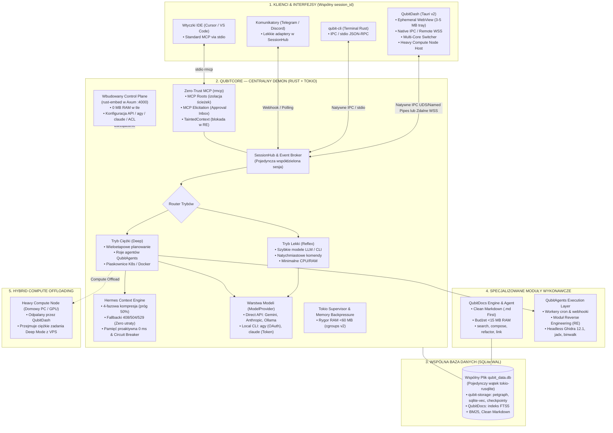

# ⚡ EKOSYSTEM QUBIT — MANIFEST ARCHITEKTONICZNY I STRATEGIA ROZWOJU (v2.0)
> **Oficjalna Dokumentacja Architektoniczna i Techniczna Ekosystemu Qubit**  
> Repozytorium: [Kvbi213/QubitCore](https://github.com/Kvbi213/QubitCore.git)  
> Data rewizji: Listopad 2026 | Architektura: Kvbi213

---

## 🎯 1. Nadrzędna Wizja i Misja Projektu

> **„Jeden Mózg, Wiele Oczu i Rąk”**

**Qubit** to autorski, ultralekki i wysoce zoptymalizowany rozproszony system operacyjny dla autonomicznych agentów sztucznej inteligencji, procesów deweloperskich i zaawansowanej automatyzacji.

System stanowi rdzenną alternatywę dla ociężałych frameworków pythonowych (typu LangChain, AutoGen czy CrewAI), które pochłaniają gigabajty pamięci RAM. Zbudowany w języku **Rust**, operuje w bezwzględnym budżecie pamięciowym (**< 60 MB RAM w spoczynku dla całego węzła demona**), gwarantując stabilną pracę 24/7 na maszynach brzegowych i tanich VPS (1 vCPU, 1 GB RAM) z możliwością dynamicznego delegowania ciężkich zadań na domowe stacje robocze (Hybrid Compute Offloading).

### Ścieżka Ewolucyjna:
1. **Faza 1 (Personal Cockpit & Daily Workspace):** Osobiste centrum dowodzenia inżyniera, integrujące edytory IDE, terminalowe CLI, aplikację desktopową oraz komunikatory mobilne we **współdzieloną sesję (`session_id`)** z obsługą lokalnych subskrypcji CLI (`agy`, `claude`) oraz Direct API.
2. **Faza 2 (Komercyjny Multi-Tenant SaaS):** Skalowanie chmurowe w Kubernetes (K8s), kryptograficzna izolacja baz danych per-tenant (SQLCipher AES-256), zarządzane piaskownice do ciężkiej analizy kodu i inżynierii wstecznej (Reverse Engineering) oraz subskrypcyjny model biznesowy.

---

## 🎨 2. Tożsamość Wizualna i Brand: „Plasma Glow”

W ekosystemie Qubit obowiązuje oficjalny, zatwierdzony design system **Plasma Glow**:
* **Paleta Barw:** Głębokie, obsydianowe tło (`#050507`), karty Bento z subtelnymi ramkami 1px (`#1A1B26`), zaakcentowane organiczną poświatą w odcieniach neonowego fioletu (`#7C3AED` / `#8B5CF6`), cyjanu (`#00F0FF`) oraz bursztynu (`#F59E0B`).
* **Sygnet Brandu:** Geometryczny glif **Q** z dynamiczną orbitą 3D, wewnątrz którego wpisany jest znak nieskończoności (`∞`), symbolizujący nieprzerwany przepływ myśli agentów, cykliczny Heartbeat oraz nieskończone możliwości automatyzacji.
* **Separacja Kontekstu:** Odcięto wszelkie zewnętrzne, historyczne nazwy pochodzące z prototypów asystentów (takie jak *„OmniDash Reborn”* czy *„Air-Gapped Two-Tier Memory _integracja z Obsidianem”*). Qubit posiada w 100% autorską, spójną tożsamość.

---

## 🏛️ 3. Architektura Przepływu Danych i Komunikacji

---

## 🏛️ 4. Siedem Filarów Ekosystemu Qubit

### Filar I: QubitCore — Centralny Mózg i Demon Runtime (Rust)
* **Technologia:** Język Rust, asynchroniczny runtime Tokio, serwer HTTP/WebSocket/SSE Axum 0.8.
* **Rola:** Główny demon pracujący w tle 24/7. Zarządza pojedynczą współdzieloną sesją (`session_id`), stanem, transakcyjną bazą SQLite WAL, routingiem zapytań i nadzorem procesów.
* **Wbudowany Control Plane (`rust-embed`):** Sam demon posiada zaszyty bezpośrednio w binarce mikro-frontend serwowany przez `axum` (0 MB dodatkowego narzutu RAM w spoczynku). Służy do technicznej administracji: rejestracji kluczy API, zarządzania subskrypcjami CLI (`agy`/`claude`), monitorowania zasobów, harmonogramu rutyn i reguł bezpieczeństwa.
* **Dwa Biegi Pracy (Dual-Gear Execution):**
  1. **Tryb Lekki (Reflex):** Błyskawiczny czas odpowiedzi, minimalne zużycie tokenów i RAM, bezpośrednie komendy shellowe, szybkie poprawki kodu bez wieloetapowego planowania.
  2. **Tryb Ciężki (Deep):** Wieloetapowa dekompozycja zadań, aktywacja roju agentów, głęboka pamięć semantyczna, izolowane piaskownice robocze.
* **Nadzór Zasobów (Memory Backpressure & Tokio Supervisor):** Ciągły monitoring anonimowej pamięci RAM (cgroups v2). Przy progu 80% wstrzymywane jest przyjmowanie nowych ciężkich zadań. Każdy podproces to izolowany task Tokio — panic w jednym zadaniu nie wpływa na stabilność demona.

---

### Filar II: QubitDash — Osobisty Pulpit Dowodzenia (Mission Control)
* **Technologia:** Tauri v2 (Rust) + TypeScript + Tailwind CSS (Preact/React) z kontraktami generowanymi przez **`specta` / `specta-typescript`** (`gen_bindings.rs`).
* **Wzorzec Ephemeral WebView:** Zużycie pamięci rzędu `~45–60 MB RAM` występuje **wyłącznie przy aktywnie otwartym oknie**. Po zminimalizowaniu do zasobnika systemowego (System Tray) QubitDash niszczy instancję WebView2/WebKit, redukując narzut w tle do **zaledwie 3–5 MB RAM** (czysty proces Rusta). Wybudzenie następuje natychmiastowo poprzez globalny skrót klawiszowy (np. `Alt + Space`).
* **Hybrydowy Transport i Multi-Core Switching:**
  * **Lokalnie:** Komunikacja przez natywne gniazda IPC (**Unix Domain Sockets / Windows Named Pipes**) z zerowym narzutem protokołu TCP/HTTP.
  * **Zdalnie:** Bezpieczne połączenie WSS/HTTPS z serwerem VPS lub chmurą SaaS.
  * **Przełącznik Węzłów:** Błyskawiczna zmiana aktywnego silnika (Local PC ↔ Remote VPS ↔ Cloud SaaS).
* **Funkcja Heavy Compute Node Host:** QubitDash pozwala zarejestrować lokalny komputer stacjonarny z dedykowanym GPU jako węzeł obliczeniowy dla 1-gigabajtowego serwera VPS, przyjmując zadania z trybu `Deep` (np. lokalne modele Ollama, ciężka dekompilacja Ghidra).
* **Główne Widoki Robocze:**
  1. **Shared Session & Agent Cockpit:** Interaktywne sterowanie zadaniami i podgląd na żywo kroków agentów w trybach `Reflex` i `Deep` (pełna synchronizacja z edytorem IDE, CLI i telefonem).
  2. **Approval Inbox (`MCP Elicitation`):** Interaktywne karty autoryzacji z podglądem diffów plików (`apply_diff`) oraz poleceń terminala (`run_terminal`) wstrzymanych przez reguły Zero-Trust / `TaintedContext`.
  3. **QubitDocs Workspace & Knowledge Graph:** Edytor czystego Markdowna połączony z interaktywną wizualizacją grafu powiązań wiedzy (`petgraph`).
  4. **Specialized Task Views:** Dedykowane pulpity analityczne, w tym podgląd postępów dekompilacji z piaskownic Reverse Engineering (`sandboxes/re-ghidra`).

---

### Filar III: Warstwa Modeli (ModelProvider) — Direct API + Local CLI Harnesses
QubitCore oferuje elastyczną warstwę dostawców modeli, łącząc bezkompromisową wydajność z oszczędnością kosztów:
1. **Direct API Drivers:** Bezpośrednia komunikacja sieciowa z Gemini API, Anthropic API, OpenRouterem oraz lokalnym serwerem Ollama.
2. **Local CLI Subscription Harnesses:** Bezgłowe mostki procesowe do narzędzi **Google Antigravity CLI (`agy`)** (autoryzacja przez aktywną sesję Google OAuth) oraz **Claude Code (`claude`)** (autoryzacja przez `claude setup-token`). Pozwala to w trybie lokalnym korzystać z nielimitowanych subskrypcji deweloperskich użytkownika bez ponoszenia kosztów per-token na API (przy zachowaniu ścisłej separacji architektonicznej pod komercyjny SaaS).

---

### Filar IV: Silnik Kontekstu i Pamięci (Hermes + OpenBot Synthesis)
Architektura łączy najlepsze rozwiązania rynkowe, eliminując narzut pamięciowy zewnętrznych frameworków:
* **Synteza z Hermes Agenta:**
  * **4-fazowa kompresja kontekstu:** Uruchamiana przy przekroczeniu 50% okna kontekstowego, chroniąca nienaruszone ostatnie 20 wiadomości operacyjnych.
  * **Drabina deterministycznych fallbacków:** W przypadku błędów przeciążenia modelu (HTTP 408, 504, 529) silnik automatycznie przełącza się na model zapasowy bez utraty wypracowanego kontekstu sesji.
  * **Pamięć proaktywna 0 ms:** Asynchroniczne wstrzykiwanie faktów z bazy wektorowej w locie z bezpiecznikiem Circuit Breaker.
* **Synteza z OpenBota (bez narzutu 1 GB RAM):**
  * **Natywny parser `SKILL.md`:** Dynamiczne wstrzykiwanie procedur inżynieryjnych w metodyce *Progressive Disclosure*.
  * **Deklaratywne pliki tożsamości `SOUL.md` i preferencji `USER.md`:** Przechowywane w strukturze plików i synchronizowane z bazą danych.
  * **Dwubiegowy Heartbeat:** Lekki cykliczny monitor (Reflex) eskalujący do pełnego planowania (Deep) w rutynach systemowych.
  * **Lekkie kanały komunikatorów:** Adaptery Telegram i Discord zintegrowane bezpośrednio w `SessionHub`.

---

### Filar V: Zero-Trust MCP (`rmcp`) i Ochrona `TaintedContext`
* **Oficjalne SDK `rmcp`:** Cała komunikacja z narzędziami realizowana jest w oparciu o protokół Model Context Protocol w rdzennym wydaniu Rust (`rmcp`).
* **MCP Roots:** Bezwzględna izolacja ścieżek systemowych — narzędzia plikowe mają dostęp wyłącznie do zadeklarowanych katalogów roboczych.
* **MCP Elicitation:** Narzędzia podwyższonego ryzyka wymagają potwierdzenia człowieka w Approval Inbox w QubitDashu.
* **Polityka Capability ACL & `TaintedContext`:** Gdy sesja przetwarza niezaufane dane zewnętrzne (strony WWW, nieznane repozytoria, pliki binarne poddawane analizie w Ghidrze), sesja zostaje oznaczona flagą `TaintedContext`. W tym stanie narzędzia modyfikujące środowisko hosta (`run_terminal`, `apply_diff`, `delete_file`, `http_request`) zostają **twardo zablokowane na poziomie dyspozytora**, zapobiegając atakom typu Indirect Prompt Injection.

---

### Filar VI: QubitDocs i Zunifikowana Baza Danych SQLite WAL
* **Clean Markdown First:** Notatki, plany i analizy są czystymi plikami `.md` z YAML Frontmatter — w 100% czytelnymi dla ludzi, kompatybilnymi z Git, Obsidianem i edytorami kodu.
* **Pojedyncza Baza `qubit_data.db`:** Zamiast rozpraszania danych na wiele plików, silnik stosuje **jeden plik SQLite WAL** obsługiwany przez dedykowany asynchroniczny wątek piszący (`tokio-rusqlite`). Baza łączy:
  1. `qubit-storage`: Modele pamięci semantycznej (`sqlite-vec`), graf wiedzy (`petgraph`) oraz transakcyjne checkpointy sesji.
  2. `QubitDocs`: Indeks pełnotekstowy FTS5 z algorytmem rankingowym BM25.
  3. Eliminacja dublowania cache'u i blokad — całkowity budżet bazy to **< 15 MB RAM**.
* **Pod-Agent `QubitDocs Agent`:** Lazy-spawn sub-agent wyposażony w deterministyczne narzędzia: `search_docs`, `compose_doc`, `expand_refactor_doc`, `link_categorize_doc`.

---

### Filar VII: QubitInstaller — Natywny Instalator w Ruście
* **Technologia:** 100% czysty Rust (`crates/qubit-installer`), skompilowany zoptymalizowanym profilem `release` pod architekturę docelową Windows x86_64 (`QubitInstaller.exe`, PE32+).
* **Rola i Zdolności:**
  * Weryfikacja środowiska stacji roboczej bez przestarzałych, poszarpanych kontrolek GDI.
  * Pobieranie oficjalnych wydań binarnych z GitHub Releases z wizualnym paskiem postępu.
  * Inicjalizacja struktury katalogów (`bin/`, `data/`, `dash/`, `docs/`) oraz wspólnej bazy `qubit_data.db`.
  * Generowanie spójnej konfiguracji `qubit_config.json` i skrótów na Pulpicie z oficjalnym sygnetem Plasma Glow.

---

## 🚀 5. Gotowość do Realizacji Etapu 1

Architektura ekosystemu Qubit została w pełni ujednolicona, pozbawiona błędnych założeń i przygotowana do natychmiastowej realizacji pierwszego etapu prac inżynieryjnych:
1. `Cargo.toml` — Ujednolicenie workspace Cargo, usunięcie zbędnych zależności i konfiguracja profilu release.
2. `crates/qubit-protocol` — Definicja struktur zdarzeń, DTO i eksport typów przez `specta` / `specta-typescript`.
3. `crates/qubit-storage` — Implementacja pojedynczego wątku `tokio-rusqlite` dla wspólnej bazy `qubit_data.db` (WAL, FTS5 BM25, petgraph, sqlite-vec).
