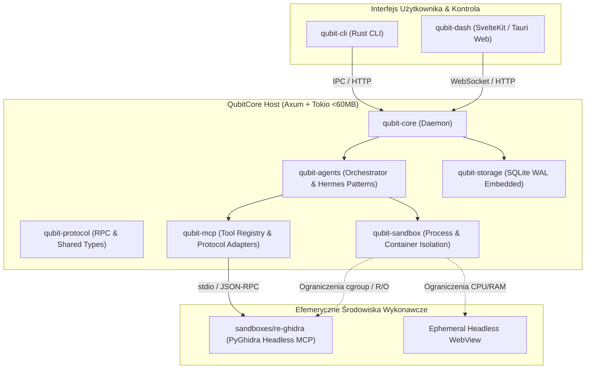
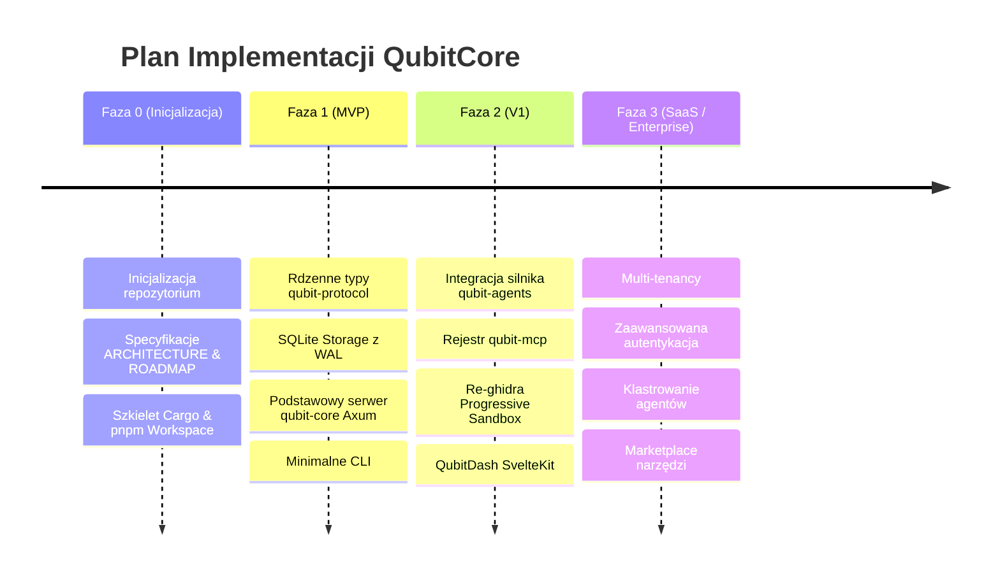

<div align="center">

# ⚛️ QubitCore

**Distributed Autonomous Agent Operating System & Low-Footprint Mission Control**

[](LICENSE)
[](https://www.rust-lang.org)
[](#ram-budget--performance-targets)
[](#implementation-roadmap)
[](https://github.com/Kvbi213/QubitCore/releases/latest/download/qubit-setup.exe)

<p align="center">
  <i>„Jeden Mózg, Wiele Oczu i Rąk”</i><br>
  <b>(One Brain, Many Eyes and Hands)</b>
</p>

</div>

---

### 📥 Pobierz Qubit dla Windows (.exe)
Najszybszy sposób na uruchomienie QubitCore na maszynie z systemem Windows to pobranie autonomicznego instalatora i bootstrapper’a:

👉 **[Pobierz najnowszą wersję: qubit-setup.exe](https://github.com/Kvbi213/QubitCore/releases/latest/download/qubit-setup.exe)**

*Bootstrapper automatycznie weryfikuje dostępność najnowszych wydań QubitCore na GitHubie, przeprowadza wstępną konfigurację środowiska, tworzy skróty i uruchamia stację Mission Control.*

---

## 📖 Spis Treści
- [Wizja & Filozofia](#-wizja--filozofia)
- [Architektura Monorepo](#-architektura-monorepo)
- [Budżet Pamięci & Wydajność (<60 MB RAM)](#-budżet-pamięci--wydajność-60-mb-ram)
- [Struktura Repozytorium](#-struktura-repozytorium)
- [Kluczowe Innowacje Architektoniczne](#-kluczowe-innowacje-architektoniczne)
- [Fazy Wdrożenia (Roadmap)](#-fazy-wdrożenia-roadmap)
- [Dokumentacja Inżynieryjna](#-dokumentacja-inżynieryjna)
- [Rozpoczęcie Pracy](#-rozpoczęcie-pracy)
- [Licencja](#-licencja)

---

## 🌌 Wizja & Filozofia

Współczesne systemy wieloagentowe cierpią na ociężałość runtime'ową (narzut Dockera/Node/Pythona sięgający 1–2 GB RAM), brak determinizmu oraz niebezpieczne udostępnianie całego środowiska hosta agentom AI.

**QubitCore** redefiniuje architekturę systemów agentowych:
1. **Jeden Mózg, Wiele Oczu i Rąk**: Centralny, lekki demon koordynacyjny w Ruście zarządza wyspecjalizowanymi, efemerycznymi narzędziami i piaskownicami poprzez standard Model Context Protocol (MCP).
2. **Budżet Pamięci < 60 MB RAM Idle**: Zdolność do stabilnego działania 24/7 na najtańszych instancjach VPS (1 vCPU, 1 GB RAM) z zachowaniem pełnej elastyczności.
3. **Progresywne Odkrywanie (Progressive Disclosure)**: Zamiast wstrzykiwać wielomegabajtowe zrzuty danych do okna kontekstowego LLM, Qubit dostarcza wielopoziomowe procedury podsumowujące (np. analiza binarna: nagłówki ➔ sekcje ➔ symbolika ➔ selektywna dekompilacja).
4. **Separacja Reflex vs Deep**: Błyskawiczne odpowiedzi na rutynowe zapytania bez kosztu instancjowania pod-agentów, połączone z zaawansowaną pętlą planowania przy zadaniach złożonych.

---

## 🏛️ Architektura Monorepo



---

## ⚡ Budżet Pamięci & Wydajność (<60 MB RAM)

Projekt zoptymalizowany pod kątem rygorystycznych ograniczeń pamięciowych na maszynach brzegowych i VPS:

| Komponent | Alokacja RAM (Target Idle) | Mechanizm Optymalizacji |
| :--- | :--- | :--- |
| **`qubit-core` + Axum** | ~12–18 MB | Kompilacja LTO, brak ciężkich frameworków, zerokosztowe abstrakcje Tokio |
| **`qubit-storage` (SQLite)** | ~4–8 MB | `cache_size = -2000` (2MB), WAL mode, wyłączone zbędne rozszerzenia |
| **`qubit-mcp` Registry** | ~3–5 MB | Pasywny rejestr w pamięci RAM, brak procesów w tle |
| **Sub-agent Orchestrator** | ~8–15 MB | Lazy-spawn mikro-agentów Hermes, natychmiastowe zwalnianie zasobów |
| **Rezerwa / Pula buforowa** | ~10–14 MB | Bezpieczny margines szczytowy |
| **SUMA CAŁKOWITA** | **< 60 MB RAM** | **Zero kontenerów Caddy/Node w pętli bezczynności** |

> [!NOTE]
> Serwer HTTP/WS został osadzony bezpośrednio w binarium `qubit-core` (Axum), co eliminuje konieczność uruchamiania dodatkowych serwerów proxy (np. Caddy zjadającego 85+ MB RAM) w scenariuszach wdrożeń jednoinstancyjnych.

---

## 📦 Struktura Repozytorium

```
.
├── Cargo.toml                    # Główny workspace Cargo (resolver "2", release LTO/strip)
├── pnpm-workspace.yaml           # Workspace pnpm dla aplikacji webowych
├── .gitignore                    # Reguły ignorowania dla Rusta, pnpm i danych
├── README.md                     # Główna dokumentacja ekosystemu
│
├── docs/                         # Specyfikacje inżynieryjne i architektoniczne
│   ├── ARCHITECTURE_SPEC.md      # Pełna specyfikacja inżynieryjna (1000+ linii)
│   ├── ECOSYSTEM_VISION.md       # Wizja strategiczna, filary i zasady projektowe
│   └── IMPLEMENTATION_ROADMAP.md # Szczegółowa mapa drogowa (Fazy 0 - MVP - V1 - SaaS)
│
├── crates/                       # Crate'y Rusta (Monorepo Workspace)
│   ├── qubit-protocol/           # Współdzielone typy, definicje RPC, eksporter TypeScript
│   ├── qubit-storage/            # Wbudowane SQLite (WAL, pragmy, automatyczne migracje)
│   ├── qubit-mcp/                # Host i klient Model Context Protocol (stdio/ws/sse)
│   ├── qubit-sandbox/            # Zarządca izolacji procesowej i kontenerowej
│   ├── qubit-agents/             # Wzorce Hermes Agent, Reflex/Deep dispatching
│   ├── qubit-core/               # Główny demon systemu (Axum HTTP/WS Hub)
│   ├── qubit-cli/                # Narzędzie linii poleceń (`qubit status`, `qubit agents`)
│   └── qubit-installer/          # Autonomiczny instalator/bootstrapper Windows/Linux (`qubit-setup.exe`)
│
├── apps/                         # Aplikacje klienckie i interfejsy
│   └── qubit-dash/               # SvelteKit + TailwindCSS Mission Control (Web / Tauri)
│
└── sandboxes/                    # Definicje wyspecjalizowanych kontenerów
    └── re-ghidra/                # Headless Ghidra Dockerfile + PyGhidra Progressive MCP
```

---

## 🛡️ Kluczowe Innowacje Architektoniczne

### 1. Progressive Disclosure dla Reverse Engineeringu
Zamiast dekompilować gigantyczne pliki binarne do gigantycznych promptów LLM:
1. **Quick Triage** (nagłówki ELF/PE, hashe, entropy, architektura) ➔ ~200 tokenów.
2. **Import/Export Analysis** (funkcje WinAPI/libc, tablice importów) ➔ ~800 tokenów.
3. **Symbol & String Filtering** (wyszukiwanie adresów krytycznych) ➔ ~500 tokenów.
4. **CFG & Call Graph** (badanie grafu wywołań wokół anomalii) ➔ ~1 200 tokenów.
5. **Targeted Decompilation** (wyłącznie wybrane, podejrzane funkcje) ➔ ~1 500 tokenów.

### 2. Zero-Config Handshake (MCP)
Rejestr `qubit-mcp` automatycznie wykrywa lokalne i zdalne serwery MCP, przeprowadza walidację schematów JSON-Schema wejścia/wyjścia i wystawia je dla silnika agentów bez konieczności restartu demona.

### 3. Air-Gapped Two-Tier Memory & Context Fact Dispatcher (QubitDocs)
Innowacja integrująca otwartą bazę wiedzy (QubitDocs) z wewnętrzną architekturą pamięci QubitCore oraz selekcjonowaniem wyłącznie istotnych faktów kontekstowych przed głównym modelem decyzyjnym:

1. **Dwa odizolowane skarbce (Two-Tier Air-Gapped Memory):**
   - **System Vault** (`.qubit/system/`): ukryta pamięć operacyjna — logi kompresji, checkpointy oraz destylowane fakty z czatów. Główny model (Claude / Gemini Pro) nie wie o jej istnieniu.
   - **User Vault** (QubitDocs / Obsidian `docs/`): jawna baza wiedzy użytkownika — notatki w czystym Markdown, plany i wiki.

2. **Context Fact Filter / Prompt Dispatcher:**
   - Mały model pomocniczy (Flint 40B, Groq, Ollama) błyskawicznie analizuje prompt i selekcjonuje z bazy QubitDocs tylko te fakty, które są precyzyjnie potrzebne do danego pytania („on pyta o to, więc fakt A i B się przyda, ale reszta 100k tokenów nie").
   - Do głównego, drogiego modelu trafia zwięzły ekstrakt (np. ~300 tokenów zamiast 80 000), co drastycznie ucina koszty i chroni limity subskrypcji AI.

3. **Promocja ekosystemu:** Użytkownik widzi, że Qubit sam buduje mu bazę wiedzy w QubitDocs i Obsidian bez wysiłku.

---

## 🗺️ Fazy Wdrożenia (Roadmap)



Szczegółowy opis poszczególnych sprintów i kryteriów akceptacji znajduje się w dokumencie [docs/IMPLEMENTATION_ROADMAP.md](docs/IMPLEMENTATION_ROADMAP.md).

---

## 📚 Dokumentacja Inżynieryjna

- 📐 [Specyfikacja Architektury Technicznej (`docs/ARCHITECTURE_SPEC.md`)](docs/ARCHITECTURE_SPEC.md)
- 🔭 [Wizja i Strategia Ekosystemu (`docs/ECOSYSTEM_VISION.md`)](docs/ECOSYSTEM_VISION.md)
- 🛣️ [Szczegółowa Mapa Drogowa i Audyt Implementacyjny (`docs/IMPLEMENTATION_ROADMAP.md`)](docs/IMPLEMENTATION_ROADMAP.md)

---

## 🚀 Rozpoczęcie Pracy

### Wymagania Wstępne
- **Rust**: `stable` (zgodnie z `rust-toolchain.toml`, Rust 2021 edition)
- **Node.js / pnpm**: Node 20+, pnpm 9+ (dla `apps/qubit-dash` opartego na Tauri v2 i Svelte 5)
- **Docker**: Wymagany jedynie do uruchamiania piaskownic (`sandboxes/re-ghidra`)

### Budowanie Monorepo
```bash
# Sklonuj repozytorium
git clone https://github.com/Kvbi213/QubitCore.git
cd QubitCore

# Zbuduj wszystkie crate'y w trybie release
cargo build --release

# Uruchom demona QubitCore
cargo run --bin qubit-core -- --bind 127.0.0.1:4000

# Sprawdź status za pomocą CLI
cargo run --bin qubit -- status
```

---

## 📄 Licencja

Projekt objęty podwójną licencją: [MIT](LICENSE) lub [Apache 2.0](LICENSE-APACHE).
Twórca i Główny Architekt: **Kvbi213** (<lisjakub2106@gmail.com>).
