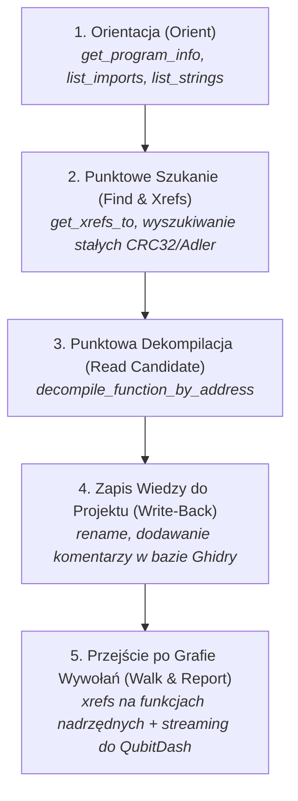
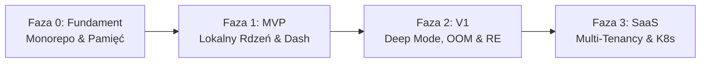

# Plan Inżynieryjny i Audyt Architektury Ekosystemu Qubit
> **Od Wizji do Wdrożenia Produkcyjnego (Faza 0 → MVP → V1 → SaaS)**  
> Dokumentacja techniczna dla repozytorium [Kvbi213/QubitCore](https://github.com/Kvbi213/QubitCore.git)

---

## Streszczenie Wykonawcze i Wnioski z Audytu

Przedstawiona specyfikacja ekosystemu **Qubit** („*Jeden Mózg, Wiele Oczu i Rąk*”) definiuje nowoczesną, opartą na języku Rust architekturę rozproszonego systemu operacyjnego dla agentów AI. Zastosowanie pojedynczego demona **QubitCore** zarządzającego współdzieloną sesją (`session_id`), dynamiczną rejestracją narzędzi w standardzie **Model Context Protocol (MCP)** oraz wbudowanej bazy SQLite z rozszerzeniem wektorowym **sqlite-vec** pozwala wyeliminować narzut pamięciowy i operacyjny typowy dla serwerów opartych na Pythonie lub Node.js (osiągając czasy zimnego startu poniżej 5 ms oraz walidację schematów w czasie kompilacji).

Aby jednak sprawnie przejść od koncepcji do działającego produktu i utrzymać rygorystyczne limity zasobów założone w projekcie (**poniżej 60 MB RAM dla kontenera silnika** i **~45 MB RAM dla aplikacji desktopowej**), architektura wymaga **czterech kluczowych korekt inżynieryjnych**:

1. **Oddzielenie serwera Caddy od procesu QubitCore w wersji MVP**: Zastąpienie wewnętrznego routingu Caddy Admin API natywnym routerem `axum` w Ruście. Caddy w kontenerze potrafi zużywać od 85 MB do ponad 1,2 GB RAM, co przekracza budżet 60 MB.
2. **Dynamiczny cykl życia okna WebView (Wzorzec Ephemeral WebView)**: Utrzymanie ~45 MB RAM w QubitDash (Tauri v2). Sam proces Rusta w Tauri zajmuje zaledwie 3–5 MB RAM. Niszczenie okna WebView po schowaniu do System Traya pozwala zredukować zużycie pamięci w tle do ~3–5 MB.
3. **Izolacja uprawnień (Capability Scoping & Zero-Trust MCP)**: Współdzielenie sesji między niezaufanymi piaskownicami (np. modułem Reverse Engineeringu) a klientem IDE udostępniającym terminal (`run_terminal`) otwiera krytyczny wektor ataku typu *Indirect Prompt Injection via Analyzed Code*. Wymusza to flagę `TaintedContext` i autoryzację *MCP Elicitation*.
4. **Bootstrapping kompresji kontekstu z Hermes Agent**: Zamiast tworzyć pętlę decyzyjną od zera, zaadaptowano sprawdzony 4-fazowy algorytm kompresji kontekstu Nous Research (próg 50%, budżet podsumowania 20%, ochrona 20 ostatnich wiadomości) oraz drabinę deterministycznych fallbacków (`DETERMINISTIC_SUMMARY_ROUTE`).

---

## 1. Krytyczny Audyt Architektury, Wąskie Gardła i Bezpieczeństwo

### 1.1. Weryfikacja budżetu pamięci RAM i wąskich gardeł wydajnościowych

Założenie utrzymania pełnego backendu (`qubit/core`) poniżej 60 MB RAM w spoczynku oraz aplikacji QubitDash w okolicach 45 MB RAM jest osiągalne w samym ekosystemie Rusta, ale zderza się z narzutem komponentów towarzyszących: serwera Caddy oraz systemowego silnika WebView.

#### 1. Wbudowanie serwera Caddy w kontener z limitem 60 MB RAM (Wąskie Gardło #1)
- Choć sam proces w Ruście zajmuje zaledwie kilka megabajtów pamięci, dołączenie do tego samego obrazu kontenerowego serwera Caddy (napisanego w Go z GC) uniemożliwi utrzymanie limitu na tanich VPS-ach 1–2 GB RAM.
- W udokumentowanych przypadkach wdrożeń Caddy potrafił rozrastać się do 450 MB – 1,2 GB RAM, doprowadzając do ubicia przez `oom-killer`.
- Nawet po optymalizacji do natywnego JSON i `idle_timeout: 5m`, zużycie Caddy wynosi ok. 85 MB RAM.
- **Rekomendacja architektoniczna:** Dynamiczny routing `/agents/*` i `/tools/*` realizowany jest bezpośrednio w procesie QubitCore za pomocą biblioteki `axum`, a Caddy pełni wyłącznie rolę zewnętrznego Edge Proxy dla środowiska produkcyjnego.

#### 2. Koszt pamięciowy QubitDash (Tauri v2 vs Slint) (Wąskie Gardło #2)
- Aplikacje Tauri v2 zużywają średnio 40–80 MB RAM (instalatory 3–10 MB, start <200 ms).
- Sam backend Rusta i warstwa IPC zajmują 3–5 MB RAM; resztę pobiera systemowy silnik WebView (WebView2 / WKWebView / WebKitGTK).
- Slint eliminuje silnik przeglądarki, ale uniemożliwia kompilację do statycznego buildu Web serwowanego przez Caddy.
- **Rozwiązanie: Wzorzec Ephemeral WebView**: Gdy QubitDash działa w tle w zasobniku systemowym (System Tray), okno WebView jest niszczone. W tle aplikacja konsumuje zaledwie **~3–5 MB RAM**. Przywrócenie okna globalnym skrótem trwa ułamki sekund.

#### 3. Współbieżność zapisów do SQLite WAL przy rojach agentów (Wąskie Gardło #3)
- Tryb WAL wspiera równoległe odczyty, lecz zapisy w SQLite są sekwencyjne. Dwa wątki klienckie operujące na tym samym połączeniu prowadzą do zakleszczeń.
- **Rozwiązanie architektoniczne:** Osobne połączenia per zadanie dla odczytów w standardowym trybie wielowątkowym (`multi-thread mode`), natomiast wszystkie zapisy (checkpointy agenta po każdym kroku, wpisy wektorowe) kierowane są przez asynchroniczny wrapper `tokio-rusqlite` do pojedynczego, dedykowanego wątku piszącego.

---

### 1.2. Audyt bezpieczeństwa: Wektory ataku i luki architektoniczne

Architektura Qubit łączy szerokie uprawnienia systemowe: dostęp do Dockera, uruchamianie procesów CLI, modyfikację kodu w IDE oraz analizę obcych binarek w module Reverse Engineeringu.

| Wektor ryzyka w specyfikacji | Mechanizm powstania podatności | Wymagane zabezpieczenie inżynieryjne w QubitCore |
| :--- | :--- | :--- |
| **1. Indirect Prompt Injection i eskalacja uprawnień (`session_id`)** | W filarze A podpięcie IDE udostępnia narzędzia `apply_diff` i `run_terminal`. Równocześnie w filarze E silnik analizuje nieznane binarki przez serwery Ghidra (ReVa / GhidraMCP). Złośliwa binarka może zawierać w ciągach znaków (`strings`) instrukcje sterujące LLM zlecające wykonanie komend w terminalu IDE. | **Capability Scoping (Zero-Trust MCP):** Narzędzia rejestrowane w sesji posiadają listę ACL. Zadania analityczne na obcych danych otrzymują flagę `TaintedContext` odcinającą dostęp do narzędzi hosta. Wywołania `run_terminal` i `apply_diff` bezwzględnie wymagają zatwierdzenia przez człowieka (*MCP Elicitation* w QubitDash). |
| **2. Ciche zabijanie procesów przez OOM Killer i błędy cgroups** | Całkowite zużycie pamięci w cgroup obejmuje cache plików (`file` w `memory.stat`), który przy intensywnej pracy z SQLite rośnie, lecz jest bezpiecznie zwalniany przez jądro. Kernel OOM Killer może zabić podproces (kod 137), podczas gdy PID 1 żyje, a Docker raportuje `OOMKilled=false`. | **Dekompozycja `memory.stat` i nasłuch `memory.events`:** Algorytm *Memory Backpressure* (próg 80%) bada wyłącznie pamięć anonimową (`anon` w `memory.stat`), z progiem alarmowym 85%. Dla każdego podprocesu CLI tworzona jest podgrupa cgroups v2 (`cgroups-rs`), a po zakończeniu procesu weryfikowany jest licznik `oom_kill` w `memory.events`. |
| **3. Ekspozycja Caddy Admin API (`localhost:2019`) na ataki SSRF** | Sterowanie Caddy przez otwarty port TCP `localhost:2019` umożliwia lokalnym podprocesom lub agentom podatnym na SSRF nieautoryzowaną modyfikację routingu i certyfikatów. | **Eliminacja portu TCP 2019:** Dynamiczny routing `/agents/*` przeniesiony do wewnętrznej tablicy w `axum`. Zewnętrzne Admin API Caddy bindowane wyłącznie do Unix Domain Socket z restrykcyjnymi uprawnieniami i flagą `--resume`. |
| **4. Uprawnienia root przez gniazdo Dockera (`bollard`) i wyciek IP w RE** | Podpięcie `bollard` do `/var/run/docker.sock` daje pełną kontrolę nad hostem. Wysyłanie dekompilowanego kodu do zewnętrznych chmurowych LLM prowadzi do wycieku własności intelektualnej. | **Izolacja Runtime'u i Modele Lokalne:** Uruchamianie kontenerów w środowisku bezuprawnieniowym (Rootless Podman / Kata Containers), twarda blokada sieci dla piaskownic RE oraz kierowanie zadań RE do modeli lokalnych (Ollama / vLLM). |

---

### 1.3. Co uprościć w pierwszej wersji (MVP) — Redukcja złożoności

1. **Zastąpienie duetu Caddy + QubitCore pojedynczą binarką `axum` w MVP**: Pojedynczy plik binarny `qubit-core` oparty na `axum` i `tokio` obsługuje WebSocket, transport HTTP+SSE dla MCP oraz serwuje statyczny build frontendu QubitDash. Eliminacja narzutu 85+ MB RAM.
2. **Natywny standard MCP zamiast budowy `@qubit/sdk` w trzech językach naraz**: Narzędzia AI i edytory (VS Code, Cursor, Zed) posiadają wbudowanych klientów MCP. W MVP wystawiany jest standardowy serwer/bramka MCP (`rmcp`) i automatyczne wiązania TypeScript dla QubitDasha (`specta`).
3. **Rezygnacja z zewnętrznej bazy grafowej na rzecz SQLite + FTS5 + sqlite-vec + petgraph**: Graf wiedzy przechowywany jest w relacyjnych tabelach SQLite, wyszukiwanie pełnotekstowe realizuje FTS5, wyszukiwanie wektorowe `sqlite-vec`, a konsolidacja grafu odbywa się wsadowo w pamięci RAM za pomocą `petgraph`.
4. **Hybrydowy Compute Offloading jako zdalny węzeł MCP**: Zamiast skomplikowanej migracji procesów, komputer PC (8+ GB RAM) uruchamia lokalny serwer MCP (np. Ghidra / Ollama) i rejestruje się w sesji `session_id` na VPS-ie jako węzeł narzędziowy.

---

## 2. Docelowa Struktura Katalogów Monorepo i Kontrakty Typów

### 2.1. Układ katalogów i pakietów w Monorepo

```
QubitCore/
├── Cargo.toml                  # Workspace Root (definicje zależności i profile release)
├── pnpm-workspace.yaml         # Workspace Root dla frontendu TS i pakietów webowych
├── docs/                       # Pełna dokumentacja architektoniczna i specyfikacje
│   ├── ARCHITECTURE_SPEC.md    # Szczegółowa specyfikacja inżynieryjna silnika
│   ├── ECOSYSTEM_VISION.md     # Wizja produktu, filary i założenia ekosystemu
│   └── IMPLEMENTATION_ROADMAP.md # Niniejszy plan wdrożenia i audyt
├── crates/                     # Modularne pakiety Rusta
│   ├── qubit-protocol/         # Single Source of Truth (DTO, zdarzenia, generatory TS/JSON)
│   ├── qubit-storage/          # SQLite WAL, sqlite-vec, refinery, FTS5, petgraph
│   ├── qubit-mcp/              # Integracja rmcp, Roots, Elicitation, Capability ACL
│   ├── qubit-sandbox/          # cgroups v2, Memory Backpressure, bollard, kube-rs
│   ├── qubit-agents/           # Pętla decyzyjna, router trybów, kompresor Hermes, RE
│   ├── qubit-core/             # Główny demon 24/7 (axum, WS, SSE, Tokio Supervisor)
│   └── qubit-cli/              # Lekki klient terminalowy (CLI) wpinający katalogi robocze
├── apps/
│   └── qubit-dash/             # Interfejs Mission Control (Tauri v2 + statyczny Web)
│       ├── src-tauri/          # Rust backend dla desktopu (System Tray, Ephemeral WebView)
│       └── ui/                 # Frontend TypeScript / Vite / Tailwind
└── sandboxes/
    └── re-ghidra/              # Konteneryzowana piaskownica Reverse Engineeringu
        ├── Dockerfile          # JDK 21, Ghidra 12.1.4/12.2, ReVa / GhidraMCP
        └── scripts/            # Skrypty wyszukiwania stałych i reversing-mcp
```

#### Tabela Odpowiedzialności Pakietów

| Ścieżka w Monorepo | Typ pakietu | Rola architektoniczna i moduły | Główne zależności wewnętrzne |
| :--- | :--- | :--- | :--- |
| `/Cargo.toml` | Cargo Workspace Root | Centralne wersje `[workspace.dependencies]`, flagi LTO i optymalizacje | — |
| `/pnpm-workspace.yaml` | pnpm Workspace Root | Zarządzanie pakietami TypeScript dla QubitDash i SDK | — |
| `/crates/qubit-protocol` | Rust Library Crate | Typy domenowe, obiekty DTO, identyfikatory sesji (`SessionId`), generator `bindings.ts` (`specta` / `schemars`) | Brak (Poziom 0) |
| `/crates/qubit-storage` | Rust Library Crate | SQLite WAL (`rusqlite`, `tokio-rusqlite`), rejestracja `sqlite-vec` przez C FFI, migracje `refinery`, FTS5, grafy `petgraph` | `qubit-protocol` |
| `/crates/qubit-mcp` | Rust Library Crate | Integracja SDK `rmcp`: dynamiczne Tools, Resources, Roots, Sampling, Elicitation oraz Capability ACL | `qubit-protocol` |
| `/crates/qubit-sandbox` | Rust Library Crate | Izolacja OS: `cgroups-rs`, dekompozycja `memory.stat` (`anon` vs `file`), orkiestracja `bollard` (Docker) i `kube-rs` (K8s) | `qubit-protocol` |
| `/crates/qubit-agents` | Rust Library Crate | Pętla agenta, router Reflex/Deep, 4-fazowy kompresor Hermes Agent, workery tła, orkiestrator RE | `qubit-protocol`, `qubit-storage`, `qubit-mcp`, `qubit-sandbox` |
| `/crates/qubit-core` | Rust Binary & Lib | Główny demon: serwer `axum` (HTTP, WebSocket, SSE), lokalne IPC, Tokio Supervisor, kolejka Backpressure | Wszystkie crates powyżej |
| `/crates/qubit-cli` | Rust Binary Crate | Klient wiersza poleceń: zgłaszanie bieżącego katalogu jako MCP Root (`list_roots`), szybkie polecenia Reflex | `qubit-protocol`, `qubit-mcp` |
| `/apps/qubit-dash` | Tauri v2 & Web | Mission Control: System Tray, Ephemeral WebView, interfejs Vite/TS serwowany lokalnie i przez sieć | `qubit-protocol` |
| `/sandboxes/re-ghidra` | Docker Piaskownica | Izolowany dekompilator Ghidra (JDK 21), ReVa/GhidraMCP, reversing-mcp, skrypty wyszukiwania stałych | — |

---

### 2.2. Synchronizacja kontraktów (@qubit/protocol): Rust → TypeScript

Do zagwarantowania spójności typów (Single Source of Truth) i wyeliminowania *wire-shape driftu* zastosowano rozdzielenie modeli bazodanowych od struktur DTO:
- **`specta` + `tauri-specta`**: Generowanie wiązań TypeScript dla wywołań IPC i zdarzeń Tauri. W przeciwieństwie do `ts-rs`, `specta` zachowuje referencje do typów zagnieżdżonych i integruje się z cyklem życia zdarzeń.
- **`schemars`**: Generowanie schematów JSON Schema dla parametrów narzędzi MCP zgodnie z wymaganiami SDK `rmcp`.
- **Binarka generatora (`src/bin/gen_bindings.rs`)**: Eksportuje plik `bindings.ts` do pakietu frontendu przed każdym buildem UI.

---

## 3. Dobór Konkretnych Bibliotek (Crates) — Sprawdzony Stos Technologiczny

| Obszar funkcjonalny | Rekomendowane Crates (Rust) | Rola i uzasadnienie techniczne |
| :--- | :--- | :--- |
| **Runtime Asynchroniczny i Nadzór** | `tokio` (v1, full), `tokio-util`, `futures` | Fundament wielozadaniowości. Każde narzędzie i pętla agenta działa jako Future zarządzany przez Tokio Supervisor z limitami czasu `timeout`. |
| **Serwer HTTP, WebSocket i SSE** | `axum`, `tower`, `tower-http` | Natywny transport HTTP/SSE dla `rmcp`, strumieniowanie tokenów, obsługa WebSocket i serwowanie statycznego UI QubitDasha. |
| **Protokół MCP (Klient i Serwer)** | `rmcp` (v1.3+), `rmcp-macros`, `schemars` | Oficjalne SDK Model Context Protocol: makra `#[prompt]`, obsługa transportów stdio i HTTP+SSE, obsługa prymitywów Roots i Elicitation. |
| **Transport Lokalny (IPC / Stdio)** | `rmcp::transport`, `tokio::net` | Bezpieczna wymiana danych przez Unix Domain Sockets i Named Pipes z pominięciem stosu TCP. |
| **Baza Danych (SQLite WAL + Wektory)** | `rusqlite` (`bundled` / `bundled-sqlcipher`), `tokio-rusqlite`, `sqlite-vec`, `refinery`, `petgraph` | Silnik relacyjno-wektorowy z pojedynczym wątkiem piszącym. Kompilacja C FFI rozszerzenia `sqlite-vec` przez `sqlite3_auto_extension()`. Szyfrowanie bazy AES-256 (`sqlcipher`). |
| **Ochrona Zasobów OS i OOM (cgroups)** | `cgroups-rs` (v0.5.1+), `cgroup-memory`, `nix`, `libc` | Programowe tworzenie grup kontrolnych cgroups v2, nakładanie limitów `memory.high` i `pids.max` oraz dekompozycja pamięci anonimowej. |
| **Orkiestracja Kontenerów i K8s** | `bollard`, `kube` (`kube-rs`) | Sterowanie Dockerem przy podnoszeniu piaskownic RE oraz zarządzanie przestrzeniami nazw (Namespaces) w Kubernetesie. |
| **Klient HTTP (LLM API i Caddy)** | `reqwest`, `serde`, `serde_json` | Asynchroniczna komunikacja z dostawcami AI (OpenAI, Ollama, vLLM, OpenRouter) oraz wysyłanie konfiguracji do Caddy. |
| **Telemetria i Błędy** | `tracing`, `tracing-subscriber`, `anyhow`, `thiserror` | Strukturalne logowanie zdarzeń i ergonomiczna dekompozycja błędów domenowych. |

---

### 3.1. Praktyczna realizacja kluczowych mechanizmów w kodzie Rusta

1. **Rejestracja `sqlite-vec` przez `sqlite3_auto_extension()`**: W module `qubit-storage` rejestracja rozszerzenia następuje przed utworzeniem bazy w Ruście. Po aktywacji WAL i tabeli wektorowej, wektory przekazywane są jako wskaźniki do surowych bajtów (`&[v.as_bytes()]`).
2. **Powiadomienia o zmianach narzędzi (`notify_resource_list_changed`)**: Przy podpięciu nowego klienta (np. IDE) serwer wysyła powiadomienie `context.peer.notify_resource_list_changed().await?`, wymuszając natychmiastowe odświeżenie możliwości w całej sesji.
3. **Automatyczne wykrywanie katalogów roboczych (`Roots`)**: Przez `server.list_roots().await?` silnik pobiera ścieżki projektowe z edytora i ogranicza przestrzeń operacyjną agentów.
4. **Bramki autoryzacji człowieka (*Elicitation*)**: Funkcja `elicit_safe` w `rmcp` wstrzymuje wykonanie i wyświetla modal w QubitDash w trybie formularza (`form mode` oparty o `schemars`) lub URL.

---

## 4. Inżynieria Pętli Agentowej, Pamięci i Modułu RE

### 4.1. Wzorce wyekstrahowane z Hermes Agent i adaptacja do QubitCore

Z architektury NousResearch/hermes-agent wyekstrahowano pięć mechanizmów inżynieryjnych:

1. **4-fazowy algorytm kompresji kontekstu (50% / 20% / 20 wiadomości)**:
   - Faza 1: Monitorowanie progu 50% okna kontekstowego (`threshold: 0.50`).
   - Faza 2: Ochrona ostatnich 20 wiadomości (`protect_last_n: 20`).
   - Faza 3: Podsumowanie środkowej części przez model pomocniczy z budżetem 20% tokenów (`_SUMMARY_RATIO = 0.20`, min 2 000, max 12 000 tokenów).
   - Faza 4: Złożenie promptu: Head messages + Summary message + nienaruszony Tail.
2. **Ochrona przed cichą utratą kontekstu**: Weryfikacja czy wycinek mieści się w oknie modelu pomocniczego (Tryb Reflex). Jeśli nie, następuje podział na transze lub przełączenie na model główny (Tryb Deep), eliminując błąd `context-length error -> None`.
3. **Drabina deterministycznych fallbacków**:
   - Pierwszy timeout: 5-minutowy cooldown.
   - Powtórny timeout (`_consecutive_timeout_failures >= 1`): Pominięcie LLM i wstrzyknięcie deterministycznego podsumowania wygenerowanego w kodzie (`DETERMINISTIC_SUMMARY_ROUTE`).
   - 3 kolejne błędy HTTP 529: Eskalacja do fallbacku `summary_overload_degraded`.
4. **Proaktywna pamięć długoterminowa z zerowym opóźnieniem (Zero-Latency Injection)**:
   - Ekstrakcja faktów i zapis do `sqlite-vec` wykonywane asynchronicznie w tle Tokio po zakończeniu tury.
   - Wstrzykiwanie wyników wyszukiwania zbuforowanych z poprzedniej tury przed generowaniem (0 ms opóźnienia).
   - *Circuit Breaker*: 5 kolejnych błędów wyłącza pamięć na 2 minuty.
5. **Delegacja sub-agentów (Zero-Context-Cost Pipelines)**: Sub-agenty uruchamiane są jako niezależne zadania z własnymi konwersacjami i narzędziami, nie obciążając okna głównego agenta.

---

### 4.2. Architektura natywnego modułu Reverse Engineering (Tryb Deep)

Piaskownica RE (`sandboxes/re-ghidra`) łączy dwa komplementarne serwery MCP w kontenerze:
1. **Serwer szybkiej analizy statycznej (`reversing-mcp`)**: Ekstrakcja stringów, nagłówki PE/ELF, entropia sekcji, `binwalk`, `jadx`, `tshark`.
2. **Serwer głębokiej analizy w Ghidrze (`ReVa` / `GhidraMCP`)**: JDK 21 + Ghidra 12.1.4/12.2 udostępniająca od 30 do 70 narzędzi analitycznych przez MCP na porcie 8080.

#### 5-Etapowa Pętla Progressive Disclosure (Dawkowanie Kontekstu)



| Etap Progressive Disclosure | Narzędzia MCP w piaskownicy | Cel analityczny i optymalizacja kontekstu |
| :--- | :--- | :--- |
| **1. Orientacja (Orient)** | `get_program_info`, `list_imports`, `list_exports`, `list_strings`, `reversing-mcp` | Identyfikacja architektury, bibliotek i podejrzanych API przy zużyciu kilkuset tokenów, bez dekompilacji kodu. |
| **2. Punktowe szukanie (Find & Xrefs)** | `get_xrefs_to` na importach/stringach + autorski skrypt Ghidry szukania stałych | Zlokalizowanie pętli deszyfrujących (np. stałe CRC-32 `0xedb88320`). Skrypt po stronie serwera eliminuje konieczność pobierania całego pseudokodu. |
| **3. Punktowa dekompilacja (Read Candidate)** | `decompile_function_by_address` | Pobranie pseudokodu C wyłącznie pojedynczej badanej funkcji. Wywołanie po adresie eliminuje niejednoznaczności nazw symboli. |
| **4. Zapis wiedzy do projektu (Write-Back)** | `rename`, dodawanie komentarzy dekompilatora w Ghidrze | Wnioski zapisywane są bezpośrednio do projektu Ghidry, a nie tylko w oknie czatu (gdzie uległyby zapomnieniu). |
| **5. Przejście po grafie wywołań (Walk & Report)** | `get_xrefs_to`, `decompile_function_by_address` na callerach, streaming WebSocket | Dzięki Write-Back każda kolejna dekompilacja wyższych funkcji automatycznie zawiera nazwane podfunkcje. Postęp strumieniowany jest do QubitDasha. |

---

## 5. Podział Wdrożenia na Fazy (Faza 0 → MVP → V1 → SaaS)



### Faza 0: Fundament Monorepo, Kontrakty i Bootstrapping Pamięci
- **Inicjalizacja Workspace:** Struktura `crates/`, `apps/qubit-dash`, konfiguracja Cargo i pnpm.
- **Kontrakty typów (`qubit-protocol`):** Automatyczna generacja `bindings.ts` (`specta`) i schematów JSON (`schemars`).
- **Warstwa bazodanowa (`qubit-storage`):** `rusqlite` (`bundled`) + `tokio-rusqlite` w trybie WAL, aktywacja `sqlite-vec` przez `sqlite3_auto_extension()`, migracje `refinery` i tabele FTS5.
- **Kompresor kontekstu Hermes Agent (`qubit-agents`):** 4-fazowy algorytm kompresji (50% próg, 20% budżet, ochrona 20 ostatnich wiadomości) oraz drabina deterministycznych fallbacków (`DETERMINISTIC_SUMMARY_ROUTE`).

### Faza 1: MVP — Lokalny Rdzeń, Współdzielona Sesja i QubitDash
- **Demon QubitCore (`axum` + `rmcp`):** Serwer HTTP/WS/SSE i lokalne IPC z obsługą współdzielonego `session_id` i dynamicznym rejestrem możliwości MCP.
- **Klient `qubit-cli` oraz podłączenie IDE:** Binarka CLI zgłaszająca katalog roboczy jako MCP Root (`list_roots`) oraz mostek do wbudowanych klientów MCP w edytorach kodu (Cursor, VS Code, Zed).
- **Aplikacja QubitDash (Tauri v2):** Działanie w System Trayu z cyklem życia **Ephemeral WebView** (~3–5 MB RAM w spoczynku) oraz obsługa bramek autoryzacji MCP Elicitation (`elicit_safe`).
- **Checkpointing stanu:** Zapis stanu pętli agenta w `qubit-storage` po każdym kroku (odporność na restart).

### Faza 2: Wersja V1 — Tryb Ciężki (Deep), Ochrona OOM i Piaskownica RE
- **Nadzór cgroups v2 i Memory Backpressure (`qubit-sandbox`):** `cgroups-rs` i `cgroup-memory` monitorujące pamięć anonimową (`anon` w `memory.stat`). Wstrzymanie kolejki przy 80%, alert przy 85%, odczyt `oom_kill` w `memory.events`.
- **Orkiestracja Docker (`bollard`) i Capability ACL:** Izolacja kontenerowa sub-agentów z flagą `TaintedContext` blokującą dostęp do hosta.
- **Piaskownica RE (`sandboxes/re-ghidra`):** Obraz Dockerowy z Ghidrą 12.1.4/12.2, ReVa/GhidraMCP, reversing-mcp oraz pętla 5-krokowego Progressive Disclosure z operacją Write-Back.
- **Proaktywna pamięć długoterminowa:** Asynchroniczna ekstrakcja faktów w tle z zerowym opóźnieniem wstrzykiwania i bezpiecznikiem Circuit Breaker (5 błędów → 2 minuty pauzy).
- **Brzegowy serwer Caddy (Edge Proxy):** Zewnętrzne proxy produkcyjne z automatycznym TLS i flagą `--resume` (`idle_timeout: 5m`).

### Faza 3: Chmurowy SaaS (Plan Pro), Multi-Tenancy i Compute Offloading
- **Bazy Database-per-Tenant z SQLCipher:** Dedykowany plik SQLite WAL per subskrybent z szyfrowaniem AES-256 (`bundled-sqlcipher`), gwarantujący fizyczną i kryptograficzną separację wektorów.
- **Orkiestracja Kubernetes (`kube-rs`) i OAuth 2.0:** Dynamiczne podnoszenie piaskownic w osobnych przestrzeniach nazw (Namespaces) z restrykcyjnym profilem bezpieczeństwa i autoryzacją OAuth 2.0.
- **Hybrydowy Compute Offloading:** Wpięcie domowego komputera PC (8+ GB RAM) jako zdalnego węzła MCP do instancji chmurowej z automatyczną delegacją lokalnych modeli (Ollama / vLLM) i dekompilacji.
