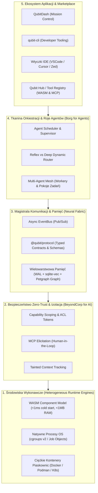

# Strategia Rozwoju Ekosystemu Qubit (Google-Grade Architecture Blueprint)
> **Wizja transformacji QubitCore z lekkiego demona w wielowarstwowy, globalny ekosystem agentowy**  
> Gałąź: `feat/qubit-kernel-foundation`  
> Autor: Antigravity AI & Qubit Core Team

---

## 1. Wstęp: Lekcja z Architektury Google

Google nie stało się dominującym ekosystemem technologicznym poprzez stworzenie jednej monolitycznej aplikacji. Jego sukces wynika z zaprojektowania **uniwersalnych warstw platformowych (Platform Engineering)**:
1. **Linux / Android / ChromeOS**: Niezawodne jądro systemowe ze ścisłą kontrolą uprawnień (Sandboxing, Linux Capabilities, Zygote).
2. **Protocol Buffers & gRPC / Stubby**: Jeden uniwersalny, wydajny, silnie typowany język komunikacji między wszystkimi serwisami.
3. **Borg / Kubernetes**: Abstrakcja maszyn fizycznych — traktowanie obliczeń i procesów jako alokowalnych zadań o gwarantowanych zasobach.
4. **Google Search & Knowledge Graph**: Globalny indeks łączący ustrukturyzowane encje, fakty i relacje, a nie tylko surowy tekst.
5. **BeyondCorp / Zero-Trust Security**: Każde żądanie, proces i użytkownik są weryfikowane dynamicznie na podstawie kontekstu i tożsamości.
6. **Ekosystem Play Store & Chrome Web Store**: Umożliwienie zewnętrznym twórcom bezpiecznego pisania rozszerzeń i aplikacji w standaryzowanym formacie piaskownicy.

Przenosząc tę filozofię na grunt **systemów autonomicznych agentów AI**, **QubitCore** nie może być po prostu kolejnym wrapperem na API OpenAI/Anthropic. QubitCore to **mikrojądro (Kernel) systemu operacyjnego nowej generacji (Agent OS)**.

---

## 2. Architektura 5 Filarów Ekosystemu Qubit

---

## 3. Kluczowe Innowacje Architektoniczne dla Skali Ekosystemowej

### 3.1. WASM-First Extensibility (Odpowiednik silnika V8 w Chrome)
- **Problem**: Obecnie piaskownice bazują na Dockerze (`sandboxes/re-ghidra`). Docker jest niezbędny dla narzędzi typu Ghidra, ale uruchamianie kontenera dla prostych narzędzi (kalkulator, parser JSON, scraper, integracja API) rujnuje budżet `< 60 MB RAM` i trwa zbyt długo (> 500 ms).
- **Innowacja ekosystemowa**: Wdrożenie silnika **Wasmtime / Extism** bezpośrednio w `qubit-sandbox`.
- **Korzyść**:
  - Drobne wtyczki i agenci kompilują się do formatu WebAssembly Component Model (`.wasm`).
  - Zimny start < 1 ms, zużycie pamięci < 1 MB na wtyczkę.
  - Zewnętrzni deweloperzy mogą pisać narzędzia w Rust, TypeScript, Go, Python i publikować je w **Qubit Registry**.
  - Izolacja pamięciowa jest w 100% bezpieczna bez potrzeby uprawnień roota czy demona Dockera.

### 3.2. Traktowanie Agenta jako Procesu Systemowego (Agent Process Lifecycle)
W systemie QubitCore każdy agent posiada strukturę przypominającą PCB (Process Control Block) w systemie operacyjnym:
- **`AgentId` & `ParentAgentId`**: Drzewo procesów agentowych (możliwość zabicia poddrzewa zadań).
- **`Priority` & `ResourceQuota`**: Przydział tokenów, maksymalny czas wykonania, limit wywołań narzędzi.
- **`State`**: `Created` ➔ `Planning` ➔ `Executing` ➔ `Blocked(Elicitation)` ➔ `Completed` / `Failed`.
- **Preemption & Signals**: Możliwość wysłania sygnału `Pause`, `Resume`, `Cancel`, `InspectState` do dowolnego agenta w czasie rzeczywistym.

### 3.3. Tkanina Pamięci: Unified Knowledge Fabric (Graf + Wektory + WAL)
Aby ekosystem skalował się jak usługi Google (np. Google Workspace czy Search), pamięć musi łączyć trzy wymiary:
1. **Episodic Memory (Dziennik zdarzeń)**: Niezmienny log zdarzeń (Event Sourcing) w SQLite WAL. Umożliwia "Time-Travel Debugging" (cofnięcie stanu agenta do dowolnego kroku).
2. **Semantic Memory (Wektory)**: `sqlite-vec` z indeksowaniem asynchronicznym w tle — szybkie wyszukiwanie podobieństwa pojęć przy 0 ms narzutu na ścieżce krytycznej tury.
3. **Associative Memory (Graf Wiedzy)**: Relacyjny graf encji oparty o `petgraph` — wiążący użytkowników, pliki, repozytoria, narzędzia, reguły biznesowe i wnioski z poprzednich zadań.

### 3.4. Local-First z Bezszwową Replikacją Chmurową (SaaS Cloud Sync)
- Ekosystem musi działać w 100% offline i lokalnie na pojedynczej maszynie (zero zależności od chmury).
- W momencie połączenia z kontem chmurowym (Plan Pro SaaS), SQLite WAL synchronizuje różnice (delta changesets) z szyfrowaniem AES-256 (SQLCipher).
- Użytkownik zaczyna zadanie w terminalu na laptopie (`qubit-cli`), weryfikuje postęp na desktopie w `QubitDash`, a ciężkie zadanie dekompilacji oddelegowuje do chmurowego węzła Kubernetes.

### 3.5. Bezpieczeństwo BeyondCorp: Dynamic Capability-Based Security
- Zamiast statycznych kluczy i nieograniczonego dostępu, każde żądanie wywołania narzędzia weryfikowane jest przez **Token Uprawnień (Capability Token)**.
- Flaga **`TaintedContext`**: Jeśli agent analizował kod, dokument lub stronę z Internetu, jego kontekst zostaje oznaczony jako "skażony" (potencjalne zagrożenie *Indirect Prompt Injection*). W tym trybie narzędzia wykonawcze hosta (`run_terminal`, `modify_file`) zostają zablokowane, dopóki człowiek nie zatwierdzi operacji w `QubitDash` (*MCP Elicitation Modal*).

---

## 4. Harmonogram 4 Tygodni: Od Szkieletu do Niezawodnego Rdzenia (Phase 1 MVP)

| Tydzień | Moduły docelowe | Zakres prac inżynieryjnych | Kryteria ukończenia (Definition of Done) |
| :--- | :--- | :--- | :--- |
| **Tydzień 1: Fundament Protokół & Pamięć** | `qubit-protocol` `qubit-storage` | 1. Implementacja pełnych typów domenowych (`SessionId`, `EngineEvent`, `CapabilityAcl`, `Manifest`). 2. Generator kontraktów TypeScript/JSON (`gen_bindings.rs`). 3. Aktor SQLite w trybie Single-Writer Multi-Reader (Tokio channel), WAL pragmy, tabele migracji (`refinery`). | • Przechodzące testy integracyjne zapisu/odczytu współbieżnego. • Wygenerowany, poprawny plik `bindings.ts`. |
| **Tydzień 2: Szyna Komunikacji & Rejestr MCP** | `qubit-mcp` `qubit-core` | 1. Implementacja klienta i mostka stdio/SSE dla Model Context Protocol (`rmcp`). 2. Wewnętrzna asynchroniczna szyna zdarzeń (`tokio::sync::broadcast`). 3. Serwer Axum z endpointami `/ws`, `/health`, `/api/v1/sessions` oraz routingiem SSE dla MCP. | • Rejestracja narzędzi MCP w locie bez restartu serwera. • Stabilny streaming zdarzeń po WebSocket z latencją < 2 ms. |
| **Tydzień 3: Pętla Decyzyjna & Pamięć Hermes** | `qubit-agents` | 1. Implementacja routera trybów: Reflex (szybka pętla bez pod-agentów) vs Deep (planowanie wielokrokowe). 2. 4-fazowy algorytm kompresji kontekstu (50% próg, 20% budżet, ochrona ostatnich 20 wiadomości). 3. Drabina deterministycznych fallbacków i Circuit Breaker. | • Testy symulujące przeciążenie kontekstu — brak błędów utraty pamięci. • Odporność na awarie i automatyczny powrót po błędach LLM. |
| **Tydzień 4: Orkiestracja, CLI & Testy E2E** | `qubit-sandbox` `qubit-cli` Weryfikacja Budżetu | 1. Wykonanie bezpiecznych procesów z timeoutami i limitami zasobów. 2. Pełny klient CLI (`qubit status`, `qubit exec`, `qubit connect`). 3. Pomiary alokacji sterty i zużycia pamięci fizycznej (RSS). | • Potwierdzone zużycie RAM procesu w spoczynku < 60 MB. • Kompletny scenariusz E2E: CLI łączy się z Core, rejestruje narzędzie i wykonuje zadanie. |

---

## 5. Podsumowanie

Ekosystem o skali Google wymaga **prostoty w jądrze i nieskończonej elastyczności na obrzeżach**.  
Dzięki temu, że QubitCore skupia się na:
- ultralekkim runtime w Ruście (<60 MB RAM),
- standardzie MCP jako uniwersalnym protokole narzędziowym,
- rozszerzeniach WASM i kontenerowych piaskownicach,
- architekturze współdzielonej sesji z wieloma interfejsami,

projekt posiada wszelkie predyspozycje architektoniczne, by w ciągu miesiąca zamknąć niezawodne jądro MVP, a w kolejnych fazach stać się uniwersalnym systemem operacyjnym dla agentów AI na rynku open-source i SaaS.
