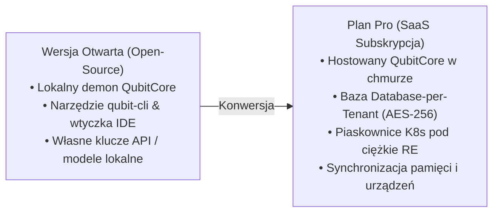

# Ekosystem Qubit — Założenia Architektoniczne i Wizja Produktu
> **Dokument koncepcyjny i fundament wizji produktowej ekosystemu Qubit**  
> Repozytorium: [Kvbi213/QubitCore](https://github.com/Kvbi213/QubitCore.git)

---

## 1. Główna Idea i Cel Projektu

Celem projektu jest zbudowanie od zera autorskiego, modularnego i ultralekkiego ekosystemu sztucznej inteligencji pod marką **Qubit** — działającego jak rozproszony system operacyjny dla agentów AI i procesów automatyzacji:
> **„Jeden Mózg, Wiele Oczu i Rąk”**

System powstaje w pierwszej kolejności jako wysoce zoptymalizowane osobiste środowisko pracy i automatyzacji programistycznej, lecz od pierwszej linijki kodu projektowany jest pod kątem **wielodostępności (multi-tenancy)**. Pozwala to na płynne i bezkosztowe wyprowadzenie platformy jako komercyjnego produktu w modelu subskrypcyjnym (SaaS).

---

## 2. Składniki Ekosystemu (Architektura Monorepo)

| Komponent | Technologia | Rola i odpowiedzialność w systemie |
| :--- | :--- | :--- |
| **QubitCore** | **Rust (Tokio)** | Centralny demon działający w tle 24/7. Zarządza sesjami (`session_id`), pamięcią, routerem trybów (Reflex vs Deep), kolejkowaniem zadań oraz kontenerami roboczymi. |
| **QubitDash** | **Tauri v2 + Statyczny Web** | Natywna, ultralekka aplikacja desktopowa (~45 MB RAM, System Tray, globalny skrót) będąca centrum dowodzenia (Mission Control). Kompiluje się również do statycznego buildu serwowanego z zerowym narzutem pamięci. |
| **QubitAgents** | **Rust + Kontenery** | Warstwa wykonawcza zastępująca zewnętrzne frameworki agentowe. Obejmuje lekkie workery w tle (cron, webhooki), mostki do IDE/CLI oraz ciężkie agenty wyspecjalizowane (np. Reverse Engineering). |
| **@qubit/protocol** | **JSON / WebSocket / IPC** | Pojedyncze źródło prawdy (Single Source of Truth) dla kontraktów zdarzeń, stanów i DTO między silnikiem, dashboardem a klientami. |
| **@qubit/sdk** | **Rust / TypeScript / Python** | Ultralekka biblioteka kliencka pozwalająca podpiąć nową aplikację (edytor kodu, terminal, urządzenie brzegowe) w kilkunastu linijkach kodu. |

---

## 3. Kluczowe Filary Architektury

### A. Współdzielona sesja i Zero-Config Handshake („Łatwe łączenie”)
- **Jeden silnik, wiele interfejsów jednocześnie:** Demon QubitCore uruchamia się raz w tle. Uruchomienie edytora kodu (IDE), terminalowego CLI oraz QubitDasha wpina wszystkie te programy do tej samej aktywnej sesji (`session_id`). Kontekst, historia i postęp prac synchronizują się w czasie rzeczywistym.
- **Dynamic Capability Registration (Standard MCP):** Brak sztywnych integracji. Każda aplikacja wysyła manifest możliwości:
  - Podpięcie IDE udostępnia silnikowi narzędzia `read_file`, `apply_diff`, `run_terminal`.
  - Podpięcie QubitDasha udostępnia narzędzia wizualizacji i bramki autoryzacji (*MCP Elicitation* / `request_human_approval`).
  - Odpięcie klienta automatycznie wyrejestrowuje narzędzia z aktywnej puli.

### B. Dwa biegi pracy: Tryb Lekki (Reflex) vs. Tryb Ciężki (Deep)
- **Tryb Lekki (Reflex):** Minimalne zużycie RAM/CPU, brak ciężkich zapytań grafowych, szybkie modele LLM, natychmiastowa egzekucja poleceń w terminalu, szybkie poprawki w kodzie i lekkie automatyzacje.
- **Tryb Ciężki (Deep):** Wieloetapowe planowanie, równoległe roje QubitAgents, głęboka pamięć długoterminowa oraz izolowane piaskownice (Docker/K8s) do dekompilacji i analizy złożonych problemów.

### C. Jeden kontener z wbudowanym Caddy i Self-Ops (Docker / Kubernetes)
- **Kompaktowy obraz backendu:** Docelowo poniżej 60 MB RAM w spoczynku.
- **Dynamiczny routing przez Caddy Admin API:** W fazie produkcyjnej Caddy zarządza certyfikatami HTTPS oraz trasami `/agents/*` i `/tools/*`. W fazie deweloperskiej i MVP routing realizowany jest bezpośrednio w natywnym `axum`.
- **Zarządzanie własną infrastrukturą:** `bollard` (Docker API) oraz `kube-rs` (Kubernetes API) pozwalają QubitCore samodzielnie podnosić i ubijać kontenery piaskownic roboczych oraz izolować klientów w Namespaces.

### D. Skalowalność sprzętowa (1–2 GB RAM vs. 8+ GB RAM) i odporność na awarie
- **Wbudowana baza danych SQLite WAL:** Zamiast zewnętrznych baz danych — lekki SQLite w trybie WAL z wektorowym rozszerzeniem `sqlite-vec`. Stan zapisywany jest po każdym kroku (checkpointing), gwarantując wznowienie prac w <10 ms po awarii.
- **Izolacja błędów (Tokio Supervisor):** Każdy agent jest nadzorowanym zadaniem Tokio z limitem czasu (`timeout`). Błąd paniki (`panic!`) pojedynczego podprocesu nie destabilizuje silnika.
- **Ochrona przed OOM (Memory Backpressure):** Monitorowanie pamięci anonimowej cgroups v2 (`anon` w `memory.stat`). Przekroczenie 80% wstrzymuje kolejkę nowych zadań.
- **Hybrydowy Compute Offloading:** Słaby serwer VPS 24/7 (1–2 GB RAM) deleguje ciężkie zadania (np. modele lokalne Ollama/vLLM lub dekompilację Ghidry) na podłączony domowy komputer PC (8+ GB RAM) jako dedykowany węzeł wykonawczy.

### E. Wyspecjalizowany Moduł: Reverse Engineering (RE)
- **Bootstrapping z Clean-Room RE:** Wykorzystanie sprawdzonych wzorców pętli decyzyjnej i kompresji kontekstu (m.in. z projektu Hermes Agent).
- **Natywna piaskownica RE (Tryb Deep):** Konteneryzowane narzędzia headless (`Ghidra 12.1.4/12.2`, `jadx`, `binwalk`, `tshark`) spięte z metodyką **Progressive Disclosure** (dawkowanie kontekstu) i raportowaniem postępów w QubitDashu.

---

## 4. Model Przejścia na SaaS (Monetyzacja i Subskrypcja)

1. **Wersja Otwarta (Open-Source / Community):**
   - Lekki klient CLI (`qubit-cli`) i wtyczki do edytorów kodu.
   - Możliwość samodzielnego uruchomienia demona QubitCore na maszynie lokalnej lub prywatnym VPS-ie z własnymi kluczami API.
2. **Plan Pro (Subskrypcja Komercyjna):**
   - W pełni zarządzana instancja chmurowa QubitCore w klastrze Kubernetes.
   - Izolacja danych w modelu **Database-per-Tenant** z kryptograficznym szyfrowaniem SQLCipher (256-bit AES).
   - Dostęp do dedykowanych chmurowych piaskownic dla zadań Trybu Deep (Reverse Engineering, audyty bezpieczeństwa, zautomatyzowane testy).
   - Globalna synchronizacja profilu pamięci, reguł i sesji pomiędzy stacjami roboczymi użytkownika.
