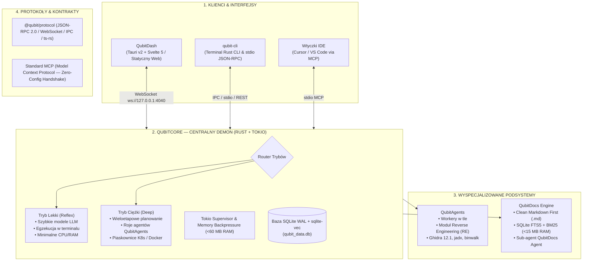

# ⚡ EKOSYSTEM QUBIT — MANIFEST ARCHITEKTONICZNY I STRATEGIA ROZWOJU
> **Dokumentacja Koncepcyjna i Techniczna Ekosystemu Qubit**  
> Repozytorium: [Kvbi213/QubitCore](https://github.com/Kvbi213/QubitCore.git)  
> Data opracowania: Listopad 2026 | Autor architektury: Kvbi213

---

## 🎯 1. Nadrzędna Wizja i Misja Projektu

> **„Jeden Mózg, Wiele Oczu i Rąk”**

**Qubit** to autorski, ultralekki i w pełni modularny rozproszony system operacyjny dla autonomicznych agentów sztucznej inteligencji, procesów deweloperskich i zaawansowanej automatyzacji.

System nie jest kolejnym ociężałym wrapperem na frameworki pythonowe (typu LangChain czy AutoGen) pochłaniającym gigabajty pamięci RAM. Jest to rdzennie zoptymalizowana platforma napisana w języku **Rust**, operująca w rygorystycznym budżecie pamięciowym (**< 60 MB RAM w spoczynku dla całego węzła**), zaprojektowana tak, by działać niezawodnie 24/7 na tanich maszynach brzegowych (1 vCPU, 1 GB RAM) oraz potężnych stacjach roboczych.

### Ewolucja z Osobistego Środowiska do Skalowalnego SaaS:
1. **Faza 1 (Aktualna — Personal Cockpit & Workspace):** Wysoce zoptymalizowane osobiste środowisko pracy dewelopera, automatyzujące zadania inżynieryjne, analizę kodu, dokumentację oraz operacje systemowe.
2. **Faza 2 (Produkt Komercyjny — Multi-Tenant SaaS):** Od pierwszej linijki kodu architektura wspiera wielodostępność (multi-tenancy), dynamiczne konteneryzowanie w Kubernetes (K8s), szyfrowanie baz danych per-tenant (SQLCipher AES-256) oraz subskrypcyjny model biznesowy (Open-Source Core vs Managed Pro Cloud).

---

## 🔍 2. Wyjaśnienie Wcześniejszych Nieporozumień Terminologicznych

W poprzednich wersjach instalatora i komunikatów pojawiły się terminy takie jak *„OmniDash Reborn”*, *„Air-Gapped Two-Tier Memory _integracja z Obsidianem”* oraz *„Plasma Glow”*. 

**Skąd to się wzięło i dlaczego było błędem?**
* Wkradło się zanieczyszczenie kontekstu pochodzące z wewnętrznych instrukcji środowiska operacyjnego OpenBota (który posiada własne profile asystentów i integracji) do publicznego kodu i brandingu projektu **QubitCore**.
* **Stan faktyczny:** Projekt QubitCore posiada własną, niezależną, czystą tożsamość techniczną opisaną w dokumentach `ECOSYSTEM_VISION.md`, `ARCHITECTURE_SPEC.md`, `QubitDash/SPECIFICATION.md` oraz `QubitDocs/README.md`. Żadne zewnętrzne naleciałości nie mają prawa redefiniować natywnego ekosystemu Qubit.

---

## 🏛️ 3. Siedem Filarów Architektury Ekosystemu Qubit

---

### Filar I: QubitCore — Centralny Mózg i Demon Runtime (Rust)
* **Technologia:** Język Rust, asynchroniczny runtime Tokio, serwer HTTP/WebSocket Axum 0.8.
* **Rola:** Działa w tle 24/7. Zarządza pojedynczą współdzieloną sesją (`session_id`), stanem, transakcyjną bazą SQLite WAL, routingiem zapytań i nadzorem procesów.
* **Dwa Biegi Pracy (Dual-Gear Execution):**
  1. **Tryb Lekki (Reflex):** Natychmiastowa reakcja, minimalny narzut tokenowy i pamięciowy, bezpośrednia egzekucja komend w terminalu, szybkie poprawki kodu bez głębokiego planowania.
  2. **Tryb Ciężki (Deep):** Złożone analizy wieloetapowe, aktywacja roju agentów, głęboka pamięć kontekstowa, uruchamianie dedykowanych piaskownic kontenerowych.
* **Ochrona Zasobów (Memory Backpressure & Supervisor):** Ciągły monitoring anonimowej pamięci RAM (cgroups v2). Przy 80% progu wstrzymywane jest przyjmowanie nowych ciężkich zadań. Każdy podproces jest izolowanym zadaniem Tokio — panic w jednym zadaniu nie wyłącza demona.

---

### Filar II: QubitDash — Graficzne Centrum Dowodzenia (Mission Control)
* **Technologia:** Tauri v2 (backend w Rust) + Frontend w Svelte 5 (oraz możliwość serwowania jako ultralekki statyczny web z serwera Axum).
* **Rola:** Lekki pulpit roboczy (~45 MB RAM w spoczynku), obecny w zasobniku systemowym (System Tray) z globalnym skrótem klawiszowym.
* **Kluczowe Widoki:**
  * **Dashboard Misji:** Stan aktywnych agentów, zużycie RAM/CPU na żywo, postęp zadań.
  * **Inspektor Grafu Wiedzy:** Interaktywna wizualizacja węzłów wiedzy semantycznej i powiązań między faktami.
  * **Konsola Telemetrii i Tracingu:** Filtrowany strumień zdarzeń na żywo (Info / Warn / Error).
  * **Centrum Decyzyjne (Approval Inbox):** Bramka Human-In-The-Loop dla operacji krytycznych (kasowanie danych, wdrożenia, modyfikacje sieci).

---

### Filar III: QubitAgents — Warstwa Wykonawcza & Moduł Reverse Engineering
* **Technologia:** Czysty Rust, brak zewnętrznych ociężałych frameworków.
* **Rola:** Wyspecjalizowani agenci roboczy uruchamiani w pętli decyzyjnej QubitCore (Lazy-Spawn):
  * Lżejsi agenci: zadania cykliczne cron, obsługa webhooków, mostki do edytorów kodu.
  * Ciężsi agenci (Deep Mode): izolowane środowiska analityczne.
* **Specjalizacja: Reverse Engineering (RE):**
  * Zintegrowane narzędzia headless (`Ghidra 12.1.4`, `jadx`, `binwalk`, `tshark`).
  * Metodyka **Progressive Disclosure** — dawkowanie dekompilowanego kodu i sekcji binarnych w małych porcjach, by nie przeciążać okna kontekstowego LLM.

---

### Filar IV: QubitDocs — Autonomiczny Silnik Dokumentacji i Bazy Wiedzy
* **Filozofia: Clean Markdown First:** Wszystkie notatki, plany i analizy zapisywane są jako czyste, ludzko czytelne pliki `.md` z metadanymi YAML Frontmatter. Zero binarnych formatów zamkniętych — 100% kompatybilności z Git, Obsidianem i Google Docs.
* **Rygor Pamięciowy < 15 MB RAM:** Zamiast ciężkich wektorowych serwerów bazodanowych — silnik SQLite FTS5 z algorytmem rankingowym BM25.
* **Pod-Agent `QubitDocs Agent`:** Lazy-spawn sub-agent w QubitCore realizujący 4 kluczowe zdolności:
  1. `search_docs`: Błyskawiczne wyszukiwanie BM25 z ekstraktami pod kontekst LLM.
  2. `compose_doc`: Tworzenie dokumentów wg ustandaryzowanych szablonów (ADR, specyfikacje).
  3. `expand_refactor_doc`: Inteligentna refaktoryzacja i synteza dokumentacji.
  4. `link_categorize_doc`: Automatyczne wykrywanie powiązań i wikilinkowanie (`[[Notatka]]`).

---

### Filar V: @qubit/protocol & @qubit/sdk
* **Single Source of Truth:** Centralna definicja typów, struktur zdarzeń i komend w Rust (`qubit-protocol`), automatycznie eksportowana do TypeScriptu przez bibliotekę `ts-rs`.
* **@qubit/sdk:** Niezwykle lekka biblioteka kliencka (Rust, TypeScript, Python) umożliwiająca podpięcie nowego programu lub skryptu do ekosystemu w kilkunastu wierszach kodu.

---

### Filar VI: Model Context Protocol (MCP) — Zero-Config Handshake
* **Dynamiczne Rejestrowanie Narzędzi:** Brak sztywnego kodowania integracji.
  * Uruchomienie wtyczki do edytora (Cursor / VS Code) automatycznie zgłasza do demona narzędzia: `read_file`, `apply_diff`, `run_terminal`.
  * Podłączenie QubitDash rejestruje `request_human_approval` oraz narzędzia wizualizacji.
  * Zamknięcie edytora natychmiast wyrejestrowuje narzędzia z aktywnej puli.

---

### Filar VII: QubitInstaller — Natywny Instalator i Bootstrapper w Rust
* **Technologia:** Czysty Rust (`crates/qubit-installer`), kompilacja do samodzielnego, niezależnego pliku wykonywalnego `QubitInstaller.exe` (PE32+ x86_64).
* **Rola:**
  1. Weryfikacja środowiska stacji roboczej (sprawdzenie wymaganych komponentów).
  2. Pobieranie oficjalnych wydań binarnych z GitHub Releases z paskiem postępu.
  3. Przygotowanie struktury katalogów (`bin/`, `data/`, `dash/`, `docs/`).
  4. Inicjalizacja transakcyjnej bazy danych SQLite WAL (`qubit_data.db`).
  5. Generowanie czystej konfiguracji środowiskowej `qubit_config.json`.
  6. Rejestracja skrótów na Pulpicie i w menu Start.

---

## 🚀 4. Podsumowanie i Kierunek Dalszych Prac

Ekosystem Qubit to przemyślana, spójna i ultralekka platforma inżynieryjna o rygorystycznych limitach pamięciowych i architekturze gotowej na komercyjną skalę.

Wszystkie kolejne kroki implementacyjne (w tym przebudowa `QubitInstaller` w czystym Rust) będą realizowane ściśle według powyższych założeń i specyfikacji technicznej.
